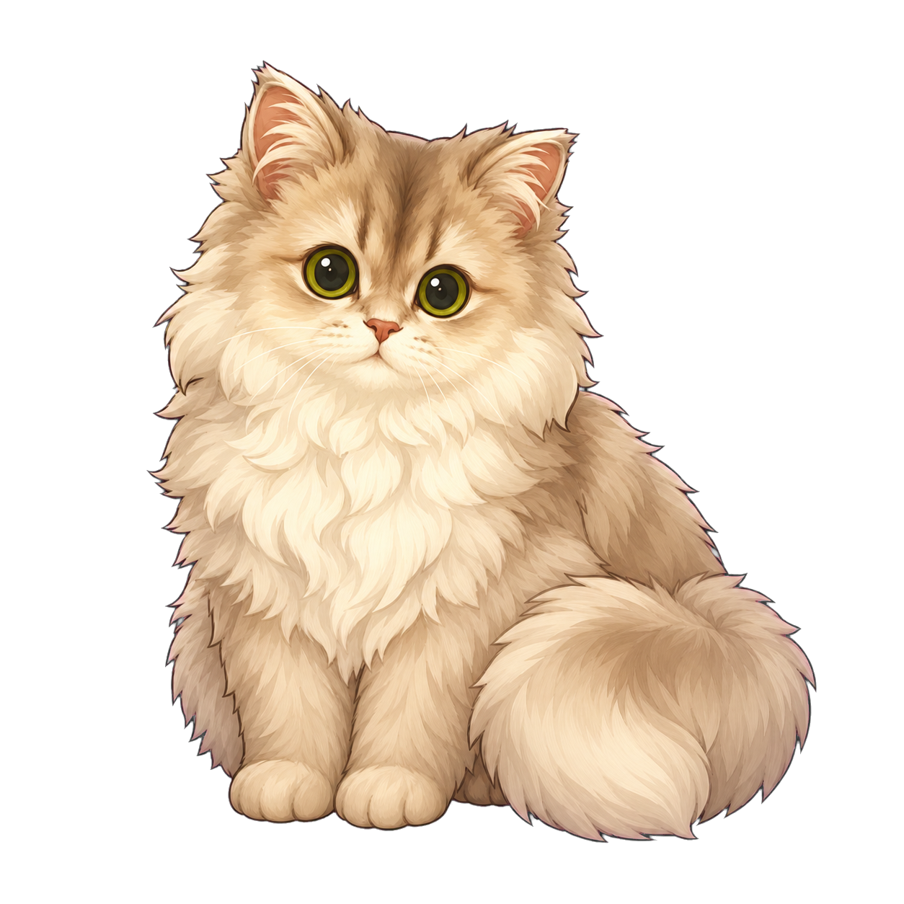

# Desktop Pet Prototype 0.1

这是桌面宠物项目的第一个 Windows 技术原型。它使用 Godot 4.7.1 和 GDScript，不包含 AI、提醒、养成或 Steam 功能。当前宠物是原创巴哥犬 **Leo** 和以真实猫咪为原型创作的长毛猫 **Bobo**。

## 项目目录

唯一主工作目录：`the project root (this repository)`

`an earlier export snapshot folder (outside this repo)` 只是早期导出快照，不参与后续开发或同步。运行、修改和测试都应在主工作目录进行。




## 已实现

- 透明、无边框窗口
- 始终置顶开关
- 拖动并保存窗口位置
- 75%–150% 显示比例
- 宠物区域接收鼠标，其他透明区域穿透
- AI 辅助制作的原创巴哥犬 Leo 母版
- 以用户参考照片为原型创作的长毛猫 Bobo 母版
- Leo 的待机呼吸、偶发摆动、键盘、鼠标和点击反应
- 自动发现 `assets/pets/*/pet.tres` 宠物包
- 右键菜单切换宠物，并在重启后恢复选择
- 宠物可以分别配置尺寸、点击轮廓、动作替代图和点击特效
- 缺少点击、键盘或鼠标动作图时自动回退到待机图
- 为动作特效预留安全边距，并防止窗口被拖到显示器可见区域之外
- 默认关闭、可暂停的匿名活动管线
- 每 100ms 聚合一次键盘/鼠标活动，避免高频事件形成动画队列
- 当前会话的键盘与鼠标分项计数，以及清除入口
- 独立 Windows Raw Input helper；游戏失去焦点时仍可接收键盘和鼠标按钮活动
- 启用时启动 helper，暂停或退出时终止，父进程异常退出后 helper 也会自动结束
- 内部自动化测试使用模拟批次验证计数与宠物动作；正式菜单不显示模拟入口
- 断开显示器后将窗口恢复到可见区域
- 25 分钟专注和 5 分钟休息计时
- 计时暂停、继续、取消和菜单倒计时
- 使用真实结束时间恢复运行中或暂停中的计时，兼容游戏重启和电脑睡眠
- 专注完成或休息完成时显示宠物气泡和高优先级提醒动作
- 专注运行时减少随机待机动作；开发环境提供 1 秒测试计时

## 活动感应与隐私

Windows 活动适配器已经接入。启用 `Activity sensing` 后，宠物在其他应用获得焦点时也会响应键盘按下和鼠标按钮按下。

活动感应默认关闭。用户第一次从菜单开启时会看到一次 Windows 原生隐私确认；确认开启后保存启用状态，以后启动自动恢复且不再重复提示。用户主动关闭后保持关闭，再次开启也不重复提示。

计数规则：

- 键盘：任意按下事件计数；松开不计数，长按产生的 Windows 自动连发会累计。
- 鼠标：左键、中键、右键、侧键 1 和侧键 2 的按下事件计数。
- 鼠标松开、移动和滚轮不计数。
- Godot 只收到 `keyboard_count` 和 `mouse_count`，不区分具体按键或按钮。

代码不会解析、暴露、记录或保存：

- 具体按键或输入文本
- 鼠标坐标
- 当前应用、窗口标题或进程
- 输入发生的时间序列

当前计数只保留在本次运行会话中；退出不会保存次数。

活动 helper 使用 Windows 自带的 .NET Framework 运行时，编译后的 x64 程序位于 `platform/windows/activity_helper/DesktopPetActivityHelper.exe`。重新编译时运行：

```powershell
powershell.exe -NoProfile -ExecutionPolicy Bypass -File .\platform\windows\activity_helper\build.ps1
```

## 打开与运行

1. 安装或解压 [Godot 4.7.1 for Windows](https://godotengine.org/download/windows/)。
2. 启动 Godot。
3. 点击 **Import**，选择本目录的 `project.godot`。
4. 打开工程后按 `F6`/`F5` 或右上角运行按钮。

当前 Codex 工作区已经带有解压后的便携版 Godot，也可以在 PowerShell 中运行：

```powershell
# 直接运行宠物
.\launch.ps1

# 打开 Godot 编辑器
.\launch.ps1 -Editor
```

启动脚本优先使用主项目内被 Git 忽略的 `.tools/godot-4.7.1`，因此不依赖日期命名的 Codex 任务目录；如果本机 `PATH` 中已有 `godot` 或 `godot4`，也会自动使用它。

## 复制到另一台 PC

当前原型可以将整个 `DesktopPet` 文件夹复制到另一台 Windows 10/11 64 位 PC，然后双击 `launch.cmd` 运行。必须一并复制 `.tools` 子目录；其中包含便携版 Godot。目标电脑不需要另外安装 Godot。

注意：

- 目标电脑需要支持 OpenGL 3.3 的显卡驱动。
- `.godot` 是可重建的导入缓存，即使没有复制，首次启动也会重新生成。
- 窗口位置、缩放、置顶、活动感应和计时状态保存在每台电脑自己的用户目录中，不会随项目文件夹复制。
- 这是开发原型的便携运行方式。面向普通玩家或 Steam 发布时，会导出独立的游戏 `.exe` 和资源包，不会附带 Godot 编辑器。

## 操作

- 左键拖动宠物：移动窗口
- 左键短按宠物：普通互动
- 左键短按 Leo 或 Bobo 的任一前爪：开始 25 分钟专注
- 从任一前爪拖动：仍然移动宠物，不会误触专注
- 宠物可以拖到屏幕可用区域边缘；透明窗口留白不再形成额外距离
- 右键宠物：打开独立的系统菜单
- 菜单中的 `Pet: <名字>`：切换当前宠物
- 菜单中的 `Activity sensing`：启用或暂停真实 Windows 活动感应
- `Activity source`：显示 Windows helper 的启动或运行状态
- `Session activity`：查看本次运行的键盘和鼠标计数
- `Clear session activity`：清除本次运行的计数
- `Start focus — 25 min`：开始专注计时
- `Start break — 5 min`：开始短休息
- `Pause timer` / `Resume timer`：暂停或继续当前计时
- `Cancel timer`：取消当前计时
- 专注结束后显示 5 秒倒计时，并自动开始休息
- `Cancel auto-start`：取消当前自动休息倒计时，保留“等待休息”状态
- 休息结束后等待用户确认，不会自动开始下一轮专注
- 菜单保持打开时，当前阶段的 `MM:SS` 倒计时会实时刷新
- 开发环境中的专注和休息 `1 sec (test)`：快速验证两种完成提醒；正式导出时隐藏
- 在菜单中关闭 `Always on top`：取消始终置顶
- 在菜单中点击 `Exit Desktop Pet`：退出
- 宠物窗口获得焦点时按 `Ctrl+Q`：快速退出

## 项目结构

```text
scenes/Main.tscn                  主场景
src/main.gd                       窗口、菜单、宠物切换和本地设置
src/Activity/activity_batch.gd    只含键盘/鼠标次数的匿名活动批次
src/Activity/activity_stats.gd    当前会话的聚合计数
src/Activity/input_activity_monitor.gd
                                  活动启停、100ms 聚合与统一事件出口
src/platform/windows/windows_activity_adapter.gd
                                  helper 进程、本地 UDP 和故障管理
src/timers/timer_manager.gd       专注/休息计时、暂停和真实时间恢复
platform/windows/activity_helper/ActivityHelper.cs
                                  Windows Raw Input helper 源码
platform/windows/activity_helper/DesktopPetActivityHelper.exe
                                  开发运行所需的 x64 helper
src/pets/pet_definition.gd        宠物资源格式
src/pets/pet_registry.gd          自动发现、校验和排序宠物包
src/pets/pet_visual.gd            所有宠物共用的显示与基础动作
assets/pets/leo/pet.tres          Leo 的宠物定义
assets/pets/leo/leo-master.png    Leo 的透明背景母版
assets/pets/bobo/pet.tres         Bobo 的宠物定义
assets/pets/bobo/bobo-master.png  Bobo 的透明背景母版
launch.cmd                        可复制到其他 Windows PC 的便携启动入口
tests/activity_pipeline_test.gd   活动管线无界面自测
tests/windows_activity_adapter_test.gd
                                  helper 注册与内部匿名批次通信自测
tests/timer_manager_test.gd       计时状态与绝对时间恢复自测
tests/focus_timer_integration_test.gd
                                  菜单、持久化和完成气泡集成自测
```

## 添加新宠物

普通新宠物不需要修改 `main.gd`、场景或通用动画代码：

1. 在 `assets/pets` 下创建以宠物 ID 命名的文件夹。
2. 放入透明 PNG 素材。
3. 创建 `pet.tres`，填写 `pet_id`、`display_name`、`idle_texture`、显示尺寸和点击轮廓。
4. 可选加入 `click_texture`、`keyboard_texture` 和 `mouse_texture`；没有提供的动作会使用 `idle_texture`。
5. 重新打开或运行项目，宠物会自动出现在右键菜单中。

完整字段和验收要求见 `docs/宠物资源包规范.md`。

## 当前原型的已知限制

- 只面向 Windows 11 验证。
- 当前包含 Leo 和 Bobo 两个正式宠物包。
- Windows 活动 helper 当前只构建为 x64。
- 真实键鼠活动仍需要在不同键盘、鼠标和长时间运行场景下继续实机验收。
- 番茄钟当前固定为 25/5；尚无自定义时长、自动连续阶段、声音或专注历史。
- 鼠标穿透区域是简化多边形，不是逐像素轮廓。
- 目前没有系统托盘；退出请使用右键菜单。
- 独占全屏应用可能覆盖置顶窗口。
- 每个新宠物包都需要配置能覆盖动作和特效的点击轮廓。
