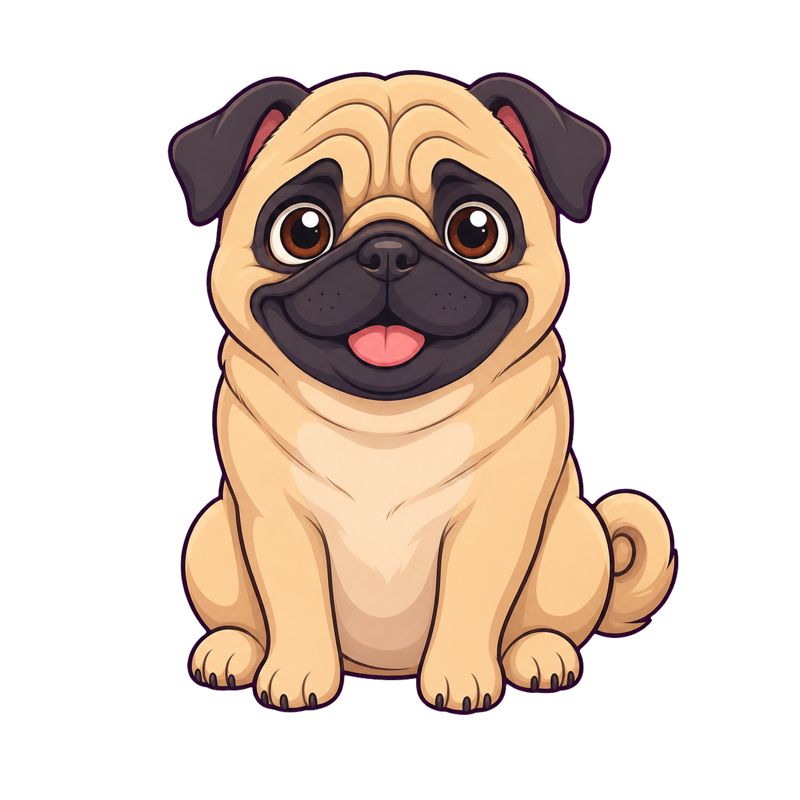

# Desktop Pet Prototype 0.1

这是桌面宠物项目的第一个 Windows 技术原型。它使用 Godot 4.7.1 和 GDScript，不包含 AI、提醒、养成或 Steam 功能。当前宠物是原创巴哥犬 **Leo** 和以真实猫咪为原型创作的长毛猫 **Bobo**。

## 项目目录

唯一主工作目录：`the project root (this repository)`

`an earlier export snapshot folder (outside this repo)` 只是早期导出快照，不参与后续开发或同步。运行、修改和测试都应在主工作目录进行。




## 已实现

- 透明、无边框窗口
- 始终置顶开关
- 拖动并保存窗口位置
- 75%–150% 显示比例
- 宠物区域接收鼠标，其他透明区域穿透
- AI 辅助制作的原创巴哥犬 Leo 母版
- 以用户参考照片为原型创作的长毛猫 Bobo 母版
- Leo 的待机呼吸、偶发摆动、键盘、鼠标和点击反应
- 自动发现 `assets/pets/*/pet.tres` 宠物包
- 右键菜单切换宠物，并在重启后恢复选择
- 宠物可以分别配置尺寸、点击轮廓、动作替代图和点击特效
- 缺少点击、键盘或鼠标动作图时自动回退到待机图
- 为动作特效预留安全边距，并防止窗口被拖到显示器可见区域之外
- 键盘动作和鼠标动作预览
- 断开显示器后将窗口恢复到可见区域

## 尚未接入

Windows 全局键盘/鼠标活动监听尚未接入这个可运行外壳。它将作为下一个独立里程碑实现，并遵守以下隐私边界：

代码不会解析、暴露、记录或保存：

- 具体按键或输入文本
- 鼠标坐标
- 当前应用、窗口标题或进程
- 输入发生的时间序列

未来的计数只保留在当前运行会话中；退出不会保存次数。

## 打开与运行

1. 安装或解压 [Godot 4.7.1 for Windows](https://godotengine.org/download/windows/)。
2. 启动 Godot。
3. 点击 **Import**，选择本目录的 `project.godot`。
4. 打开工程后按 `F6`/`F5` 或右上角运行按钮。

当前 Codex 工作区已经带有解压后的便携版 Godot，也可以在 PowerShell 中运行：

```powershell
# 直接运行宠物
.\launch.ps1

# 打开 Godot 编辑器
.\launch.ps1 -Editor
```

启动脚本优先使用主项目内被 Git 忽略的 `.tools/godot-4.7.1`，因此不依赖日期命名的 Codex 任务目录；如果本机 `PATH` 中已有 `godot` 或 `godot4`，也会自动使用它。

## 复制到另一台 PC

当前原型可以将整个 `DesktopPet` 文件夹复制到另一台 Windows 10/11 64 位 PC，然后双击 `launch.cmd` 运行。必须一并复制 `.tools` 子目录；其中包含便携版 Godot。目标电脑不需要另外安装 Godot。

注意：

- 目标电脑需要支持 OpenGL 3.3 的显卡驱动。
- `.godot` 是可重建的导入缓存，即使没有复制，首次启动也会重新生成。
- 窗口位置、缩放和置顶设置保存在每台电脑自己的用户目录中，不会随项目文件夹复制。
- 这是开发原型的便携运行方式。面向普通玩家或 Steam 发布时，会导出独立的游戏 `.exe` 和资源包，不会附带 Godot 编辑器。

## 操作

- 左键拖动宠物：移动窗口
- 左键短按宠物：互动
- 右键宠物：打开独立的系统菜单
- 菜单中的 `Pet: <名字>`：切换当前宠物
- 菜单中的 `Preview keyboard reaction` 和 `Preview mouse reaction`：预览未来的键鼠动作
- 在菜单中关闭 `Always on top`：取消始终置顶
- 在菜单中点击 `Exit Desktop Pet`：退出
- 宠物窗口获得焦点时按 `Ctrl+Q`：快速退出

## 项目结构

```text
scenes/Main.tscn                  主场景
src/main.gd                       窗口、菜单、宠物切换和本地设置
src/pets/pet_definition.gd        宠物资源格式
src/pets/pet_registry.gd          自动发现、校验和排序宠物包
src/pets/pet_visual.gd            所有宠物共用的显示与基础动作
assets/pets/leo/pet.tres          Leo 的宠物定义
assets/pets/leo/leo-master.png    Leo 的透明背景母版
assets/pets/bobo/pet.tres         Bobo 的宠物定义
assets/pets/bobo/bobo-master.png  Bobo 的透明背景母版
launch.cmd                        可复制到其他 Windows PC 的便携启动入口
```

## 添加新宠物

普通新宠物不需要修改 `main.gd`、场景或通用动画代码：

1. 在 `assets/pets` 下创建以宠物 ID 命名的文件夹。
2. 放入透明 PNG 素材。
3. 创建 `pet.tres`，填写 `pet_id`、`display_name`、`idle_texture`、显示尺寸和点击轮廓。
4. 可选加入 `click_texture`、`keyboard_texture` 和 `mouse_texture`；没有提供的动作会使用 `idle_texture`。
5. 重新打开或运行项目，宠物会自动出现在右键菜单中。

完整字段和验收要求见 `docs/宠物资源包规范.md`。

## 当前原型的已知限制

- 只面向 Windows 11 验证。
- 当前包含 Leo 和 Bobo 两个正式宠物包。
- Windows 全局活动监听尚未接入。
- 鼠标穿透区域是简化多边形，不是逐像素轮廓。
- 目前没有系统托盘；退出请使用右键菜单。
- 独占全屏应用可能覆盖置顶窗口。
- 每个新宠物包都需要配置能覆盖动作和特效的点击轮廓。
