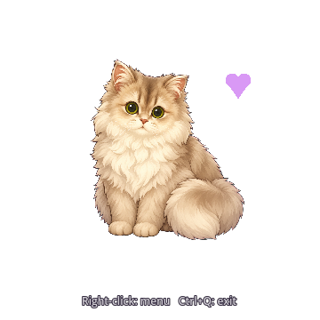

# Desktop Pet

A low-distraction desktop companion for Windows: a cartoon pet that sits on top of your desktop, reacts to your activity, and helps with focus sessions and health reminders.

Built with **Godot 4.7.1 / GDScript**, plus four small **C# native Windows helpers**. The project was developed largely with AI coding agents (OpenAI Codex), with design decisions, privacy rules and acceptance criteria written down in [`AGENTS.md`](AGENTS.md) and [`docs/`](docs/) so each agent session follows the same rules.



> 中文说明见 [README.zh-CN.md](README.zh-CN.md). The design docs in `docs/` and `AGENTS.md` are in Chinese.

## Features

- **Four pets**: Leo and Milo (pugs), Bobo (British Longhair cat) and Mable (Siberian cat), each drawn from photos of real pets. Every pet has blink, happy-click, keyboard, mouse, focus and reminder animations plus personality idles (look around, yawn, stretch).
- **Transparent desktop window**: borderless, always-on-top (auto-yields when another app goes fullscreen), click-through outside the pet's silhouette, 75%–300% scaling, multi-monitor safe.
- **Focus timer**: Pomodoro-style focus and break sessions with pause/resume, restored from real wall-clock time across restarts and sleep.
- **Health reminders**: water and stand-up reminders with snooze, quiet hours, and deferral while a focus session is running.
- **Pet Notes**: small in-picture notes for a daily briefing, weather (Open-Meteo) and upcoming events from your own Google Calendar.
- **Activity Center and tray menu**, single-instance launch, English / Simplified Chinese UI.

## Engineering highlights

- **Privacy-first activity sensing.** A separate Windows Raw Input helper process counts key presses and mouse-button presses and sends Godot only two aggregate numbers per 100 ms batch. No key codes, text, mouse coordinates, window titles or process names ever cross the process boundary. Sensing is off by default, opt-in, pausable and clearable.
- **Google Calendar, read-only.** Desktop OAuth Authorization Code flow with PKCE, a random `state` and a loopback redirect. The refresh token is stored in Windows Credential Manager through a dedicated helper; the access token lives only in memory. Disconnecting is crash-safe: it persists a "do not restore" flag before deleting credentials.
- **Native Windows integration without touching window styles.** Small C# helpers handle taskbar hiding (`ITaskbarList::DeleteTab`), fullscreen detection (window bounds + native frame styles, with a Direct3D exclusive-fullscreen fallback) and credential storage, each talking to Godot over a narrow local protocol.
- **Data-driven pets.** `PetRegistry` discovers self-contained pet packages under `assets/pets/*/pet.tres`. Behaviors follow a versioned spec (`desktop_pet_behavior_v1`) with frame rate, playback mode, weight, cooldown and a fixed priority (Reminder > Click > Keyboard/Mouse > Idle). Adding a pet never requires core code changes, and missing animations fall back safely to the idle frame.
- **Tested.** 30+ automated Godot test suites cover the activity pipeline, timers and reminders, pet behaviors and dialogue, localization, check-in queueing, OAuth/PKCE parsing, credential storage, single-instance coordination and the fullscreen/always-on-top state machine.

## Running

1. Install [Godot 4.7.1 for Windows](https://godotengine.org/download/windows/).
2. Import `project.godot` and press **F5**, or run `.\launch.ps1` from PowerShell.

Windows 10/11 x64 only. Google Calendar sync needs your own Desktop OAuth client JSON (`client_secret*.json`, git-ignored) in the project root; everything else works without it.

## Project layout

```text
src/main.gd            window, menus, settings
src/Activity/          anonymous activity batches and aggregation
src/pets/              pet definitions, behavior system, dialogue
src/timers/            focus timer and health reminders
src/checkins/          Pet Notes queue, weather, Google Calendar
src/platform/windows/  adapters for the native helpers
platform/windows/      C# helper sources and build scripts
assets/pets/           self-contained pet packages
tests/                 automated test suites
docs/                  design docs and the pet-package spec (Chinese)
```

## License

[MIT](LICENSE)
