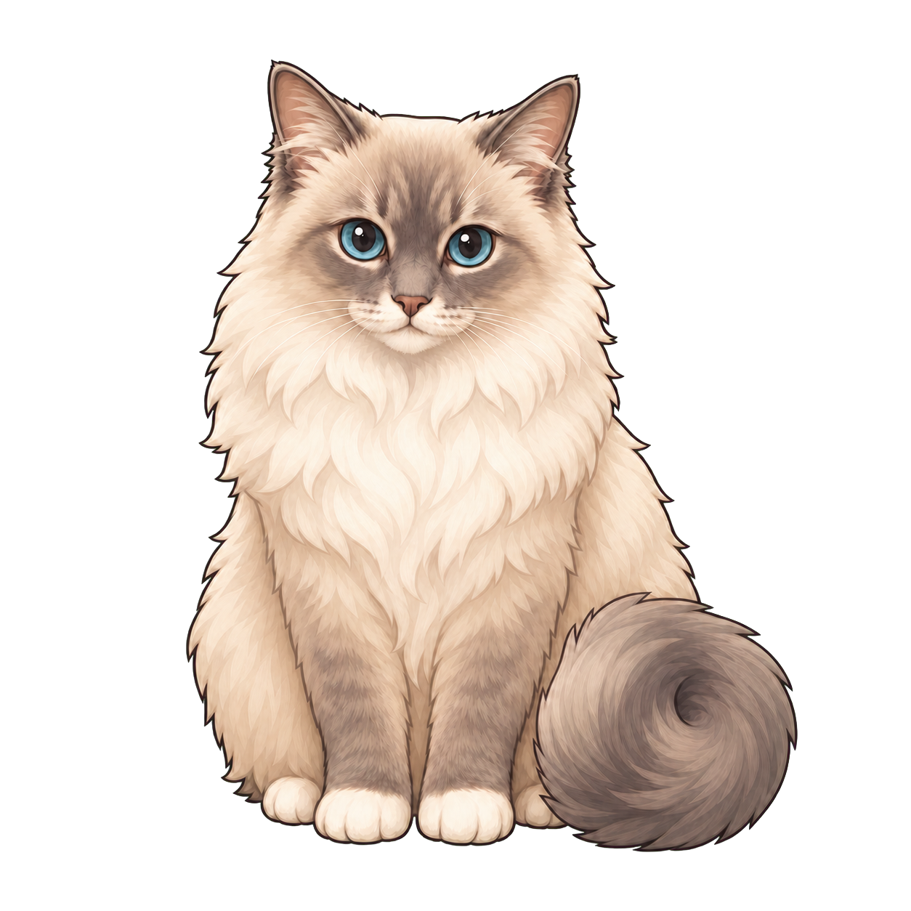

# Desktop Pet Prototype 0.1

这是桌面宠物项目的第一个 Windows 技术原型。它使用 Godot 4.7.1 和 GDScript，已包含专注计时与基础健康提醒，但不包含 AI、养成或 Steam 功能。当前宠物是黑色巴哥犬 **Leo**、英国长毛猫 **Bobo**、金黄色巴哥犬 **Milo**，以及蓝眼灰面罩的西伯利亚森林猫 **Mable**。

## 项目目录

唯一主工作目录：`the project root (this repository)`

`an earlier export snapshot folder (outside this repo)` 只是早期导出快照，不参与后续开发或同步。运行、修改和测试都应在主工作目录进行。




## 已实现

- 透明、无边框窗口
- 始终置顶开关
- 拖动并保存窗口位置
- 75%–300% 显示比例；宠物右键菜单字体、行距和留白同步缩放
- 宠物区域接收鼠标，其他透明区域穿透
- 以用户参考照片为原型创作的黑色巴哥犬 Leo 母版，采用与 Bobo 统一的简洁卡通色块和柔和阴影；黑色四肢与银灰眼周在小尺寸下保持清晰
- 以用户参考照片为原型创作的英国长毛猫 Bobo 母版
- 将早期金黄色巴哥犬原型完整保留为第三只宠物 Milo
- 以用户提供的真实照片为原型创作蓝眼西伯利亚森林猫 Mable 母版，以较大的圆眼和柔和面罩呈现友善卡通表情
- Leo 的待机呼吸、偶发摆动、键盘、鼠标和点击反应
- 数据驱动的多帧宠物行为资源：支持随机待机、点击、键盘、鼠标、Focus
  和 Reminder 触发，以及帧速、播放方式、权重与冷却
- 标准 `desktop_pet_behavior_v1` 生成规范和自动校验；旧单图宠物包继续
  安全回退
- Leo 已接入首个试产行为 `idle_blink`：空闲时自动使用现有睁眼待机图
  和一张新闭眼帧完成自然眨眼
- Leo 的 `click_happy` 在左键点击时切换为开心笑脸并配合轻微跳起与爱心，
  笑容保持约 1 秒后自动回到待机状态；跳起和爱心仍保持短促
- Leo 的 `focus_calm` 在 Focus 期间持续使用安静清醒的专注姿态：先保持
  5 秒平静睁眼，再用 1 秒完成一次缓慢半眨眼，随后无缝循环；结束 Focus
  后恢复普通待机
- Leo 的 `reminder_attention` 在 Focus/Break 完成或健康提醒出现时切换为
  温和前倾、轻抬前爪的注意姿势，并与待机帧低频往返约 2.4 秒；提醒结束后
  自动恢复此前状态
- Leo 的 `keyboard` 在检测到匿名聚合键盘活动时，以 6 FPS 交替轻点左右
  前爪约 0.5 秒；持续输入只延长动作而不重置到第一帧，Focus 期间播放后
  会自动回到 `focus_calm`
- Leo 的 `mouse` 在检测到匿名聚合鼠标按钮活动时，以 4 FPS 在两个好奇
  侧头姿势间切换约 0.5 秒；它不读取或追踪鼠标坐标，持续点击只延长当前
  动作，Focus 期间结束后恢复 `focus_calm`
- Leo 已完成 `desktop_pet_behavior_v1` 的六项核心行为，并通过完整档案、
  画布尺寸、帧数和独立贴图预算校验
- Leo 的首个可选个性动作 `idle_look` 会在非 Focus 的空闲时段低频出现：
  左右观察约 3 秒、20 秒冷却，不读取或暗示鼠标位置
- Leo 的 `idle_yawn` 会更少出现：开始、完整哈欠和困倦收尾共约 3 秒，
  使用 90 秒冷却，Focus 期间不触发
- Leo 的 `idle_stretch` 是目前最少出现的个性动作：坐姿前倾、双前爪前伸
  再收回约 3 秒，使用 150 秒冷却，后腿和尾巴保持落地
- Bobo 已使用同一流程完成六项核心行为：闭眼、开心笑容、左右前爪轻点、
  双向好奇侧头、平静 Focus 缓眨和轻抬前爪的 Reminder 注意动作；这验证了
  标准行为包可以复用于长毛猫，而不需要在核心代码中加入宠物特例
- Bobo 也已完成三项个性待机动作：用视线和耳朵观察、猫科比例的低频哈欠，
  以及长毛覆盖下的前爪伸展；触发参数与 Leo 共用标准配置，但姿势独立生成
- Mable 已完成同一套六项核心行为，保留冰蓝圆眼、灰色面罩、白手套、
  厚毛领和右侧蓬松尾巴；所有关键帧使用统一脚底基线和深梅棕轮廓
- Mable 也已完成左右观察、自然哈欠和前爪伸展三项个性待机动作；观察以
  冰蓝视线和耳朵为主，伸展时白手套向前延伸且后躯与灰色大尾巴保持落地
- Milo 也已完成六项核心行为；点击仍保持原本克制的巴哥笑容，键盘动作
  使用左右前爪轻点，鼠标活动使用一对更活泼但不读取坐标的好奇歪头
- Milo 也已完成左右观察、短口鼻自然哈欠和低伏前伸三项个性待机动作；
  棕色圆眼、深色面罩、短腿和右侧卷尾在全部关键帧中保持一致
- 可复用接触表工具先校验六项核心行为，再把已发现的可选行为关键帧一并放在
  浅色与深色背景上检查；四只宠物的接触表分别保存在各自宠物包的
  `authoring/behavior-contact-sheet.png`
- 编辑器环境的 `Developer > Behavior preview… / 开发测试 > 动作预览…`
  会打开非模态双语窗口；可滚动按钮列表从当前宠物包动态生成，核心、可选和
  未来自定义行为都能直接预览，窗口和文字随宠物显示比例缩放
- 自动发现 `assets/pets/*/pet.tres` 宠物包
- 右键菜单切换宠物，并在重启后恢复选择
- 宠物可以分别配置尺寸、点击轮廓回退、动作替代图和点击特效；运行时优先根据 PNG alpha 自动生成贴合轮廓
- 缺少点击、键盘或鼠标动作图时自动回退到待机图
- 为动作特效预留安全边距，并防止窗口被拖到显示器可见区域之外
- 默认关闭、可暂停的匿名活动管线
- 每 100ms 聚合一次键盘/鼠标活动，避免高频事件形成动画队列
- 当前会话的键盘与鼠标分项计数，以及清除入口
- 独立 Windows Raw Input helper；游戏失去焦点时仍可接收键盘和鼠标按钮活动
- 启用时启动 helper，暂停或退出时终止，父进程异常退出后 helper 也会自动结束
- 内部自动化测试使用模拟批次验证计数与宠物动作；正式菜单不显示模拟入口
- 断开显示器后将窗口恢复到可见区域
- 25 分钟专注和 5 分钟休息计时
- 计时暂停、继续、取消和菜单倒计时
- 使用真实结束时间恢复运行中或暂停中的计时，兼容游戏重启和电脑睡眠
- 专注完成或休息完成时显示宠物气泡和高优先级提醒动作
- 普通状态结果气泡 2.5 秒自动关闭；Focus/Break 完成气泡保留 5 秒并提供 `OK` 提前关闭
- 专注运行时减少随机待机动作；开发环境提供 1 秒测试计时
- 两层右键菜单；顶层保持紧凑并实时显示当前专注或休息状态
- 默认关闭、可独立启用的喝水与站立活动提醒
- 健康提醒提供完成、按当前设置延后和关闭此类提醒，并按真实时间跨重启恢复
- 独立双语弹窗可一次设置专注、休息、喝水、站立和延后的默认分钟数；可一键恢复 25 / 5 / 60 / 45 / 10 分钟，保存前只修改表单，运行中的计时不会被重置
- 每日勿扰时段可在独立设置窗口中启用或关闭，并分别选择开始与结束小时
- 专注期间暂存已到期的健康提醒，在休息开始后再用宠物动作和气泡提示
- 健康提醒气泡可直接点击完成、延后或关闭此类提醒；气泡收起后点击宠物可重新打开
- “活动中心 / Activity Center”可从宠物右键菜单或 Windows 托盘打开，以状态卡片集中显示专注、喝水、站立和勿扰时段，并处理常用操作
- 活动中心显示待处理提醒数量和本次运行最近 5 条 Focus/Break 与健康提醒事件；最近活动可手动清除，退出程序后自动清空
- 可选的“宠物小纸条 / Pet Notes”会在非专注、非勿扰且没有待处理提醒时显示在宠物图片上；`OK` 按钮显示关闭倒计时，也可手动关闭
- 启用 Pet Notes 后，每个本地日期第一次启动会生成一张最多三行的每日简报：第一行把简短的早上好、下午好或晚上好与日期合并，下面按可用性各保留一行天气和下一项日历事件；每行会按当前字体和缩放比例独立省略，长事件标题不会产生隐藏的第四行；缺少的数据自动省略，成功显示后当天不再重复
- Pet Notes 信息源使用统一标准卡片契约；日历已迁移，Developer 菜单提供不联网的双语模拟天气入口，用于测试来源、优先级队列、本地化和气泡显示
- 天气支持手动城市、主动查看、每三小时自动刷新和最近成功结果缓存；不请求系统定位，也不保存 Open-Meteo 返回的经纬度
- 数据驱动的本地预写对白第一阶段：Leo、Bobo、Mable 与 Milo 可在点击、开始/完成 Focus、完成健康提醒和低频空闲时使用各自性格的简短对白；对白 ID 与宠物包内语言资源分离，新增语言无需修改核心代码，全局与场景冷却避免重复打扰
- `Settings` 可随时关闭宠物对白；编辑器 Developer 菜单提供按当前宠物包动态生成的对白预览窗口，预览不消耗正常冷却
- 菜单、宠物气泡和系统对话框支持 English / 简体中文，并保存语言选择

## 活动感应与隐私

Windows 活动适配器已经接入。启用 `Activity sensing` 后，宠物在其他应用获得焦点时也会响应键盘按下和鼠标按钮按下。

活动感应默认关闭。用户第一次从菜单开启时会看到一次 Windows 原生隐私确认；确认开启后保存启用状态，以后启动自动恢复且不再重复提示。用户主动关闭后保持关闭，再次开启也不重复提示。

计数规则：

- 键盘：任意按下事件计数；松开不计数，长按产生的 Windows 自动连发会累计。
- 鼠标：左键、中键、右键、侧键 1 和侧键 2 的按下事件计数。
- 鼠标松开、移动和滚轮不计数。
- Godot 只收到 `keyboard_count` 和 `mouse_count`，不区分具体按键或按钮。

代码不会解析、暴露、记录或保存：

- 具体按键或输入文本
- 鼠标坐标
- 当前应用、窗口标题或进程
- 输入发生的时间序列

当前计数只保留在本次运行会话中；退出不会保存次数。

活动 helper 使用 Windows 自带的 .NET Framework 运行时，编译后的 x64 程序位于 `platform/windows/activity_helper/DesktopPetActivityHelper.exe`。重新编译时运行：

```powershell
powershell.exe -NoProfile -ExecutionPolicy Bypass -File .\platform\windows\activity_helper\build.ps1
```

任务栏 helper 只调用 Windows Shell 的 `ITaskbarList::DeleteTab`，不会修改窗口样式。重新编译时运行：

```powershell
powershell.exe -NoProfile -ExecutionPolicy Bypass -File .\platform\windows\taskbar_helper\build.ps1
```

凭据 helper 只允许读写 `DesktopPet.*` Generic Credential，refresh token 不通过命令行或临时文件传递。重新编译时运行：

```powershell
powershell.exe -NoProfile -ExecutionPolicy Bypass -File .\platform\windows\credential_helper\build.ps1
```

## 打开与运行

1. 安装或解压 [Godot 4.7.1 for Windows](https://godotengine.org/download/windows/)。
2. 启动 Godot。
3. 点击 **Import**，选择本目录的 `project.godot`。
4. 打开工程后按 `F6`/`F5` 或右上角运行按钮。

当前 Codex 工作区已经带有解压后的便携版 Godot，也可以在 PowerShell 中运行：

```powershell
# 直接运行宠物
.\launch.ps1

# 打开 Godot 编辑器
.\launch.ps1 -Editor
```

启动脚本优先使用主项目内被 Git 忽略的 `.tools/godot-4.7.1`，因此不依赖日期命名的 Codex 任务目录；如果本机 `PATH` 中已有 `godot` 或 `godot4`，也会自动使用它。

## 复制到另一台 PC

正式测试包位于 `dist\DesktopPet-Windows`。将整个目录复制到另一台 Windows 10/11 64 位 PC，保持主程序和三个 helper 在同一目录，然后运行 `DesktopPet.exe`；目标电脑不需要 Godot 或 `.tools`。源码开发方式仍可复制整个项目和 `.tools` 后使用 `launch.cmd`。

注意：

- 目标电脑需要支持 OpenGL 3.3 的显卡驱动。
- `.godot` 是可重建的导入缓存，即使没有复制，首次启动也会重新生成。
- 窗口位置、缩放、置顶、活动感应和计时状态保存在每台电脑自己的用户目录中，不会随项目文件夹复制。
- 这是开发原型的便携运行方式。面向普通玩家或 Steam 发布时，会导出独立的游戏 `.exe` 和资源包，不会附带 Godot 编辑器。

## 操作

- 左键拖动宠物：移动窗口
- 左键短按宠物：普通互动
- 左键短按 Leo、Bobo、Milo 或 Mable 的任一前爪：开始 25 分钟专注
- 从任一前爪拖动：仍然移动宠物，不会误触专注
- 宠物可以拖到屏幕可用区域边缘；透明窗口留白不再形成额外距离
- 右键宠物：打开独立的快捷菜单
- 顶层 `Focus — ...`：实时显示计时状态，并打开专注操作子菜单
- `Pets` 子菜单：切换当前宠物
- `Activity` 子菜单中的 `Activity sensing`：启用或暂停真实 Windows 活动感应
- `Activity source`：显示 Windows helper 的启动或运行状态
- `Session activity`：查看本次运行的键盘和鼠标计数
- `Clear session activity`：清除本次运行的计数
- `Start focus — 25 min`：开始专注计时
- `Start break — 5 min`：开始短休息
- `Pause timer` / `Resume timer`：暂停或继续当前计时
- `Cancel timer`：取消当前计时
- 专注结束后显示 5 秒倒计时，并自动开始休息
- `Cancel auto-start`：取消当前自动休息倒计时，保留“等待休息”状态
- 休息结束后等待用户确认，不会自动开始下一轮专注
- 顶层菜单或 `Focus` 子菜单保持打开时，当前阶段的 `MM:SS` 倒计时会实时刷新
- `Developer` 子菜单中的专注和休息 `1 sec (test)`：快速验证两种完成提醒；正式导出时整个子菜单隐藏
- `Window` 子菜单中的 `Always on top`：切换始终置顶
- `Window` 子菜单中的 `Scale`：切换宠物显示比例
- `Activity Center…`：打开非独占状态窗口；可开始、暂停、继续或取消 Focus/Break，并对指定的到期提醒执行 Done、Snooze 或 Turn off
- Water/Stand 关闭时，活动中心卡片显示 `Turn on`；运行中显示 `Turn off`；到期后切换为 `Done / Snooze / Turn off`，无需返回右键 Reminders 子菜单
- Water/Stand 的单一开关按钮与名称、状态位于同一行；到期后的三枚处理按钮才使用下一行。Quiet Hours 的 `Edit…` 也位于对应卡片右侧
- 活动中心底部的 `Set durations` 与 `Quiet hours…` 复用现有设置窗口，不维护第二套设置数据
- 有提醒待处理时，宠物右键与托盘入口显示数量；活动中心按时间倒序显示最近 5 条会话事件，并可用 `Clear` 单独清空
- `Reminders` 子菜单：独立开启或关闭喝水与站立提醒，并实时查看下一次提醒倒计时
- `Settings` → `Set durations`：打开独立窗口，一次设置 Focus、Break、Water、Stand 和 Snooze 的默认分钟数
- 保存的新时长从下一轮开始生效；已经运行中的专注、休息或健康提醒保留原截止时间
- `Quiet hours`：点击后打开独立设置窗口；可启用或关闭，并从固定为约 8 行、可滚动且为滚动条保留足够宽度的下拉菜单中选择 00:00–23:00 的开始与结束时间。右键菜单用勾选标记启用状态，正文显示 `Quiet hours: 20:00–08:00` 一类紧凑范围；绿色状态点表示当前生效，灰色状态点表示已启用但当前未生效。勿扰期间到期的提醒保持待处理，结束后再显示
- 健康提醒到点后只提供三种结果：`Done`、按当前设置 `Snooze`，或 `Turn off`
- 提醒气泡直接显示这三个按钮，不再通过 `More` 打开二级操作菜单
- `Done` 会开始下一个正常周期；`Snooze` 会按设置的延后时长再次提醒；`Turn off` 会停止该类周期，直到在 `Reminders` 菜单重新开启
- 提醒气泡自动收起后，左键短按宠物可再次打开当前待处理提醒
- `Developer` 子菜单中的喝水和站立 `1 sec (test)`：快速验证两种健康提醒；正式导出时隐藏
- `Settings` → `Language…`：打开独立语言选择窗口；首次安装跟随 Windows 系统语言，无法识别时回退 English；当前支持 English 和简体中文，选择会在重启后恢复
- `Settings` → `Pet Notes…`：设置非专注时的宠物小纸条；可启用每日简报，连接、同步或断开用户自己的 Google Calendar，也可开启 `Show automatic weather notes / 自动显示天气小纸条`、手动填写城市并点击 `Check now / 立即检查`
- `Activity` → `Weather now / 查看天气`：主动在宠物图片上查看天气。此入口不要求开启 Pet Notes 或自动天气；没有城市时会打开设置，30 分钟内的缓存直接显示，较旧时联网刷新
- 主动天气不受六小时自动小纸条冷却限制；如果健康提醒正在显示，天气会等待到提醒关闭后再出现
- 天气获取使用 Open-Meteo 的地理编码与天气预报接口。成功结果最多每六小时自动生成一张低优先级小纸条；若同一时段的天气已经包含在每日简报中则不再单独显示，跨重启也保持该去重状态。日历事件仍优先显示，断网不会清空最近的成功天气
- 城市名与不含经纬度的天气快照保存在本地设置中；程序不读取 Windows 定位。天气正文和设置页均保留 Open-Meteo attribution
- Open-Meteo 免费公开接口适合当前非商业原型；Steam 或其他商业发布前，需要改用符合商业使用条款的 Open-Meteo 方案或替换提供者。端点封装在独立 provider 中，业务队列与界面无需绑定具体服务
- Google Calendar 登录在系统浏览器完成，只申请日历列表与事件只读权限；同步层计划每 15 分钟刷新未来三天事件
- Google Calendar 使用 Desktop OAuth client、PKCE、随机 `state` 和 loopback 回调；该 Desktop client 的 token 交换要求其配套 client secret
- Godot 编辑器开发环境从项目根目录中被 Git 忽略的 `client_secret*.json` 加载配置；正式 Windows 导出通过插件把同一 Installed client 配置注入发行包，普通用户无需复制 JSON
- Google 明确说明 Installed/Desktop 应用无法保密，随应用提供的 client secret 不被视为机密；仓库仍不提交明文值，正式构建从本地 JSON 或 CI 进程环境变量读取，以减少误提交和自动扫描风险
- 时间、语言和 Pet Notes 设置窗口会随说明文字自动调整高度；内容超过屏幕可用空间时正文区域滚动，底部操作按钮始终保留在窗口内
- 宠物图片上的提醒和 Pet Note 对话气泡限制最大文本行数，过长内容以省略号裁切，不会把操作按钮挤出气泡
- refresh token 安全保存在当前 Windows 用户的凭据管理器中，重启后自动恢复登录；access token 仍只保存在进程内存。主动断开时会先持久禁止自动恢复，再删除已保存登录，因此立即退出也不会在下次启动重新连接
- `Developer` → `Pet Note — 10 sec (test)`：验证图片内小纸条、按钮倒计时和自动关闭
- 程序在 Windows 通知区域显示托盘图标；托盘菜单可显示/隐藏宠物、开始专注、打开 Pet Notes 或退出
- 托盘菜单也可直接打开 Activity Center；仅打开、刷新或关闭窗口不会改变计时与提醒，只有明确点击操作按钮才会修改对应状态
- 活动中心最近事件只使用白名单结构：事件类型、Focus/Break/Water/Stand 分类及小时分钟；不接受或保存具体按键、鼠标坐标、应用名称和任意文本
- 程序提供 Windows 通知区域托盘入口；主宠物窗口通过 `ITaskbarList::DeleteTab` 隐藏任务栏按钮，不修改 Godot 窗口样式
- 宠物右键菜单保持无焦点窗口的稳定打开路径，并继续实时刷新计时状态；不得在菜单开关时切换透明主窗口焦点样式
- Windows 默认通过 ANGLE（Direct3D 11）运行 Compatibility renderer，避免部分 AMD 原生 OpenGL 驱动把透明窗口区域合成为黑色；ANGLE 不可用时回退到原生 OpenGL
- 自动化测试使用独立的 `user://` 设置文件，不得覆盖正式应用的计时、提醒或语言设置；旧版测试写入的 `40/8/75/35/15` 指纹会在启动时恢复为产品默认值并清除测试 reminder 状态
- 宠物显示比例同时调整右键主菜单和下级菜单的字体、行距与留白；Windows 原生托盘菜单继续由系统 DPI 控制
- 在菜单中点击 `Exit Desktop Pet`：退出

## 项目结构

```text
scenes/Main.tscn                  主场景
src/main.gd                       窗口、菜单、宠物切换和本地设置
src/Activity/activity_batch.gd    只含键盘/鼠标次数的匿名活动批次
src/Activity/activity_stats.gd    当前会话的聚合计数
src/Activity/input_activity_monitor.gd
                                  活动启停、100ms 聚合与统一事件出口
src/platform/windows/windows_activity_adapter.gd
                                  helper 进程、本地 UDP 和故障管理
src/platform/windows/windows_taskbar_adapter.gd
                                  只删除任务栏按钮的 Windows Shell 适配器
src/platform/windows/windows_credential_store.gd
                                  Windows 凭据 helper 会话与 OAuth 安全存取
src/timers/timer_manager.gd       专注/休息计时、暂停和真实时间恢复
src/timers/reminder_manager.gd    喝水/站立周期、延后、按日暂停和持久化
src/localization/app_localization.gd
                                  英语/简体中文用户界面词典与语言回退
src/checkins/check_in_manager.gd  小纸条队列、去重、过期、冷却与显示时长
src/checkins/pet_note_card.gd     统一小纸条字段、校验和规范化
src/checkins/pet_note_source.gd   日历、天气和新闻共用的信息源契约
src/checkins/calendar_check_in_source.gd
                                  定时/全天日历事件的小纸条触发
src/checkins/daily_briefing_source.gd
                                  简短问候、日期、天气和下一事件的每日聚合简报
src/checkins/mock_weather_check_in_source.gd
                                  不联网的双语模拟天气开发测试源
src/checkins/open_meteo_weather_provider.gd
                                  城市解析、实时/当日天气获取与离线缓存恢复
src/checkins/weather_check_in_source.gd
                                  双语天气内容、六小时去重、优先级与 attribution
src/checkins/google_calendar_provider.gd
                                  Google Desktop OAuth、只读同步与事件标准化
src/checkins/google_oauth_client_config.gd
                                  OAuth 发行配置校验、固定 client ID 与注入路径
addons/google_oauth_export/       Windows 导出时注入 Installed client 配置
assets/ui/tray_icon.svg           Windows 通知区域托盘图标
platform/windows/activity_helper/ActivityHelper.cs
                                  Windows Raw Input helper 源码
platform/windows/activity_helper/DesktopPetActivityHelper.exe
                                  开发运行所需的 x64 helper
platform/windows/taskbar_helper/TaskbarHelper.cs
                                  ITaskbarList::DeleteTab helper 源码
platform/windows/taskbar_helper/DesktopPetTaskbarHelper.exe
                                  开发运行所需的 x64 任务栏 helper
platform/windows/credential_helper/CredentialHelper.cs
                                  Windows Credential Manager helper 源码
platform/windows/credential_helper/DesktopPetCredentialHelper.exe
                                  开发运行所需的 x64 凭据 helper
platform/windows/export_release.ps1
                                  注入 OAuth 配置并导出正式 Windows EXE
src/pets/pet_definition.gd        宠物资源格式
src/pets/pet_behavior_definition.gd
                                  通用多帧行为、触发、播放与选择参数
src/pets/pet_behavior_profile.gd  版本一标准行为清单与资源预算校验
src/pets/pet_dialogue_entry.gd    单个上下文的稳定对白 ID 与冷却
src/pets/pet_dialogue_locale.gd   可自动发现的单语言对白字典
src/pets/pet_dialogue_profile.gd  版本化对白 ID、语言发现与英语回退
src/pets/pet_dialogue_manager.gd  语言选择、去重、冷却与低频空闲调度
src/pets/pet_registry.gd          自动发现、校验和排序宠物包
src/pets/pet_visual.gd            所有宠物共用的显示、行为调度与安全回退
docs/宠物行为生成流程.md           照片到标准行为包的版本化生产流程
assets/pets/leo/pet.tres          Leo 的宠物定义
assets/pets/leo/leo-master.png    Leo 的透明背景母版
assets/pets/bobo/pet.tres         Bobo 的宠物定义
assets/pets/bobo/bobo-master.png  Bobo 的透明背景母版
assets/pets/milo/pet.tres         Milo 的宠物定义
assets/pets/milo/milo-master.png  Milo 的透明背景母版
assets/pets/mable/pet.tres        Mable 的宠物定义
assets/pets/mable/mable-master.png Mable 的透明背景母版
launch.cmd                        可复制到其他 Windows PC 的便携启动入口
tests/activity_pipeline_test.gd   活动管线无界面自测
tests/windows_activity_adapter_test.gd
                                  helper 注册与内部匿名批次通信自测
tests/timer_manager_test.gd       计时状态与绝对时间恢复自测
tests/focus_timer_integration_test.gd
                                  菜单、持久化和完成气泡集成自测
tests/reminder_manager_test.gd    健康提醒周期、延后、暂停与恢复自测
tests/health_reminder_integration_test.gd
                                  健康提醒菜单、可点击气泡、语言与专注暂存集成自测
tests/activity_center_integration_test.gd
                                  活动中心状态、精确操作、入口、缩放与本地化集成自测
tests/activity_center_session_log_test.gd
                                  会话事件白名单、5 条上限、深拷贝与清除自测
tests/pet_behavior_system_test.gd 多帧播放、标准档案、优先级、Focus 与回退自测
tests/pet_dialogue_manager_test.gd 对白档案、语言、去重、冷却与空闲调度自测
tests/pet_dialogue_integration_test.gd 点击/Focus、优先级、开关与四宠物预览自测
tests/localization_test.gd         本地化目录完整性、语言回退与格式化自测
tests/check_in_manager_test.gd     小纸条队列、过期与日历触发规则自测
tests/pet_note_source_test.gd      标准卡片、来源约束、优先级与模拟天气自测
tests/daily_briefing_integration_test.gd 每日简报、三行上限、英中问候与持久去重自测
tests/weather_provider_test.gd     城市/天气响应解析、缓存和天气卡片规则自测
tests/ambient_card_integration_test.gd
                                  图片内小纸条、天气设置/预览、倒计时与抑制集成自测
tests/google_calendar_provider_test.gd
                                  PKCE、回调解析、时区与 Google 事件标准化自测
tests/windows_credential_store_test.gd
                                  一次性假 token 的安全写入、读取和删除自测
tests/google_calendar_disconnect_policy_test.gd
                                  主动断连、立即重启与重新授权策略自测
tests/system_tray_integration_test.gd
                                  任务栏隐藏、托盘菜单和显示/隐藏行为自测
tests/windows_transparency_configuration_test.gd
                                  Windows 透明窗口与 ANGLE 回退配置自测
tests/google_oauth_packaged_config_test.gd
                                  对导出包内 OAuth 注入配置做黑盒自检
```

## 添加新宠物

普通新宠物不需要修改 `main.gd`、场景或通用动画代码：

1. 在 `assets/pets` 下创建以宠物 ID 命名的文件夹。
2. 放入透明 PNG 素材。
3. 创建 `pet.tres`，填写 `pet_id`、`display_name`、`idle_texture`、显示尺寸和点击轮廓。
4. 新行为包按 `desktop_pet_behavior_v1` 加入多帧行为资源；旧包仍可使用
   `click_texture`、`keyboard_texture` 和 `mouse_texture`。
5. 重新打开或运行项目，宠物会自动出现在右键菜单中。

完整字段和验收要求见 `docs/宠物资源包规范.md`；从照片生成身份母版、
动作帧、接触表和运行时包的流程见 `docs/宠物行为生成流程.md`。

## 导出带 Google Calendar 的 Windows 版本

1. 为 Godot 4.7.1 安装版本完全一致的 Windows export templates。
2. 将 Installed/Desktop OAuth JSON 保留为项目根目录下被 Git 忽略的 `client_secret*.json`。
3. 运行：

```powershell
powershell.exe -NoProfile -ExecutionPolicy Bypass `
  -File .\platform\windows\export_release.ps1
```

脚本会校验固定 client ID，通过进程环境把 client 配置交给 Godot 导出插件，并清理后重建 `dist\DesktopPet-Windows` 中的 `DesktopPet.exe`、`DesktopPetActivityHelper.exe`、`DesktopPetCredentialHelper.exe` 和 `DesktopPetTaskbarHelper.exe`。四个 EXE 必须一起分发并放在同一目录。每次导出还会先删除旧的 `dist\DesktopPet-Windows.zip`，再把完整输出目录重新压缩为同名 ZIP，供复制和分发。测试 PCK 位于独立的 `dist\tests`，不会混入正式包。原始 JSON 不会进入发行包；插件只加入运行所需的规范化 `client_id` 与 `client_secret`。CI 可改用 `DESKTOP_PET_GOOGLE_CLIENT_ID` 和 `DESKTOP_PET_GOOGLE_CLIENT_SECRET` 两个受保护环境变量，不需要创建 JSON。

如果发行配置缺失或 client ID 不匹配，应用会在打开浏览器前显示配置错误。不要把 Desktop client secret 当作用户数据或访问令牌：它随 Installed 应用分发且可被提取；真正能访问个人日历的是每位用户授权后生成并保存于其 Windows 凭据管理器中的 refresh token。

## 当前原型的已知限制

- 只面向 Windows 11 验证。
- 当前包含 Leo、Bobo、Milo 和 Mable 四个正式宠物包。
- Windows 活动 helper 当前只构建为 x64。
- 真实键鼠活动仍需要在不同键盘、鼠标和长时间运行场景下继续实机验收。
- 番茄钟支持自定义专注和休息默认分钟数；尚无自动连续阶段、声音或专注历史。
- 健康提醒支持自定义喝水、站立和延后分钟数，并通过独立窗口设置每日勿扰时段；尚无声音、Windows 系统通知或完整的多分类设置页。
- 宠物小纸条已完成 Google Calendar OAuth、只读同步和 Windows Credential Manager 持久登录；编辑器使用被 Git 忽略的本地 JSON，正式 Windows 发行包在导出阶段注入 Desktop client 配置。公开发布前仍需完成 Google OAuth 应用验证，并在独立电脑上验收导出包登录。
- 当前只提供 English 和简体中文；宠物名称仍使用宠物包中定义的专名。
- 鼠标穿透区域由待机 PNG 的 alpha 自动生成简化多边形，并保留动作与点击爱心所需的小范围安全边距；它不是逐像素命中。
- 活动中心已支持 Focus 操作、Reminder 开关与到期处理、待处理数量和会话级最近事件；不提供跨重启历史或趋势图，也不在卡片内编辑时长或勿扰时间。
- 独占全屏应用可能覆盖置顶窗口。
- 每个新宠物包仍需配置能覆盖动作和特效的回退点击轮廓；正常运行优先使用自动 alpha 轮廓。
